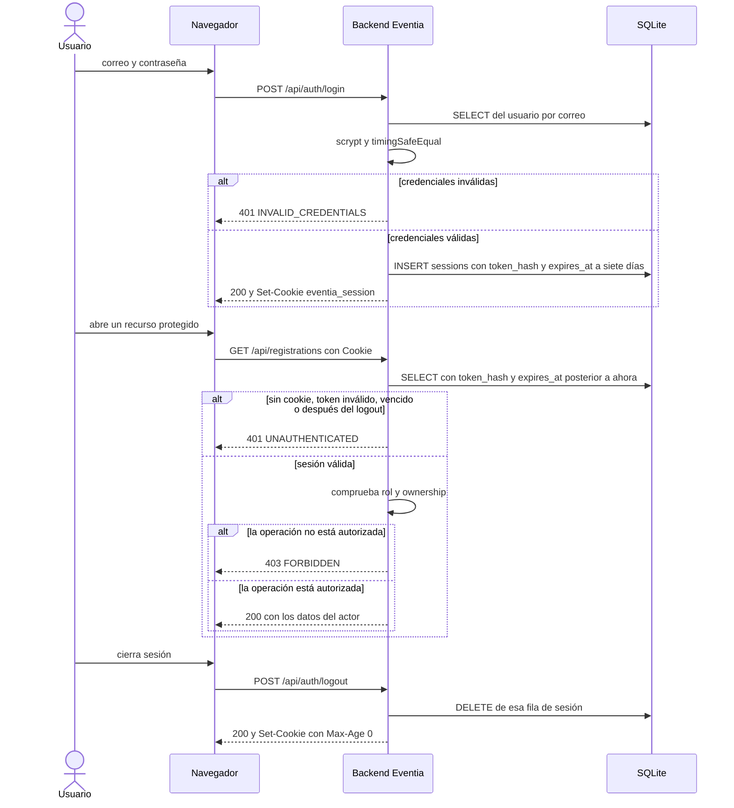

# Flujo de autenticación con sesión opaca

El diagrama cubre el alta de sesión, una petición a un recurso protegido, el rechazo cuando la sesión venció y el cierre de sesión. El recurso de ejemplo es `GET /api/registrations`.

## Qué hace el backend con la contraseña

`users.login` busca el correo y verifica la contraseña con scrypt. Si el correo no existe, igual deriva un hash de relleno. Así la respuesta no sale antes solo porque la cuenta falta. El resultado de un fallo es `401 INVALID_CREDENTIALS`. Ese código no es el de una sesión ausente.

## Qué pasa cuando la sesión venció

`authenticate` no devuelve actor si `expires_at` ya no es posterior a ahora. La primera ruta protegida responde `401 UNAUTHENTICATED` y no evalúa el rol. La captura está en `evidencias/prueba-6.txt`.

Una cookie con 64 hexadecimales que nunca se guardó toma la misma rama. La captura está en `evidencias/prueba-6-token-invalido.txt`.

## Qué pasa al cerrar sesión

`POST /api/auth/logout` borra el hash de esa cookie. La respuesta pone `Max-Age=0` para que el navegador descarte `eventia_session`. La petición protegida siguiente vuelve a la rama de actor nulo.
