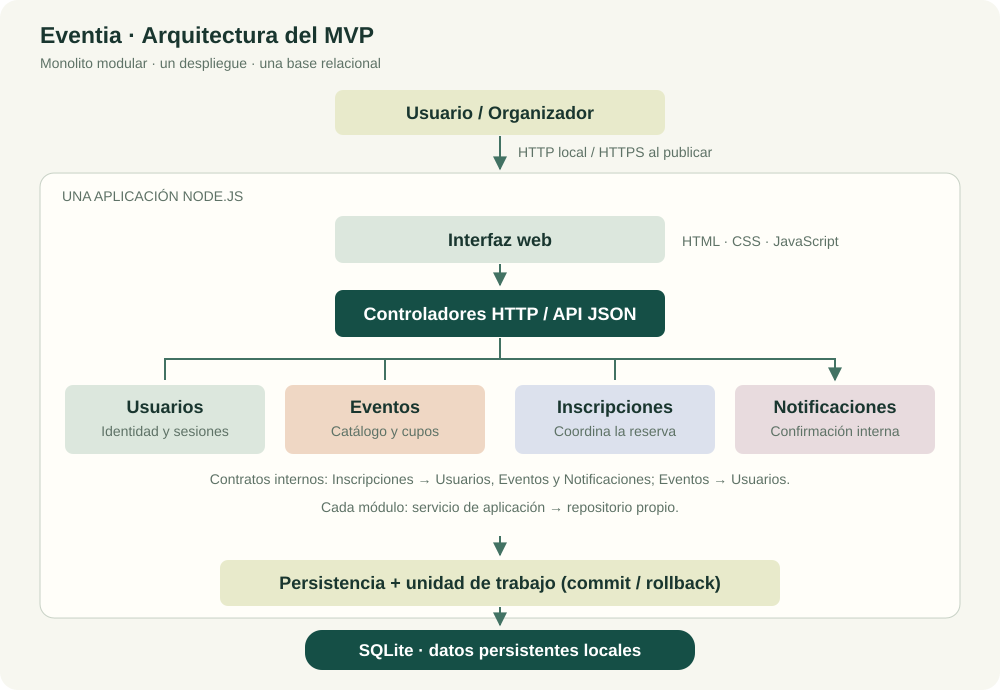
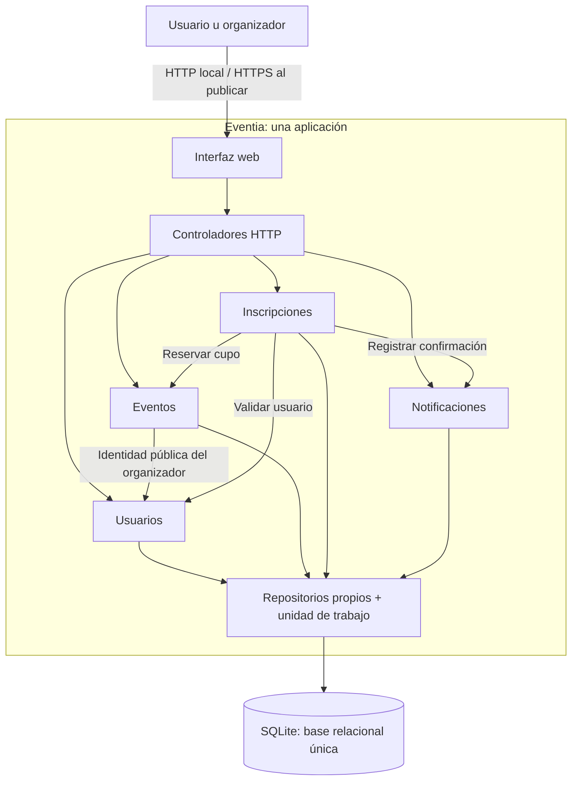

# Eventia: diseñar hoy, escalar mañana

**Fase 1: diseñar y construir el MVP**  
Curso: Programación Web · Universidad Rafael Landívar  
Fecha de entrega preparada: 5 de octubre de 2026

## 1. Definición del MVP

### Problema y valor

Eventia conecta a organizadores que desean publicar actividades con personas que quieren descubrirlas e inscribirse. La empresa comienza con un equipo pequeño y necesita validar el uso de la plataforma.

El MVP permite **publicar un evento, encontrarlo y reservar una plaza con confirmación**, manteniendo correctos los cupos. El objetivo inicial es observar si los organizadores publican y si las personas se inscriben; no se presupone la carga del escenario de cinco años después.

### Incluimos en el MVP

| Funcionalidad | Alcance construido | Justificación |
|---|---|---|
| Registro de usuarios | Registro, inicio y cierre de sesión; cuentas de participante y organizador. | Identifica a quien publica y se inscribe y permite proteger sus datos. |
| Publicación de eventos | Título, descripción, categoría, lugar, fecha/hora y capacidad; solo organizadores. | Genera la oferta necesaria para que la plataforma entregue valor. |
| Consulta y búsqueda | Catálogo de próximos eventos, detalle, búsqueda por título o descripción y filtro por categoría. | Permite descubrir una actividad relevante. |
| Inscripción | Un usuario autenticado reserva un lugar por evento. | Completa la acción principal del producto. |
| Control de cupos | Disponibilidad visible y reserva transaccional sin sobrecupo. | Impide aceptar más personas que la capacidad del evento. |
| Consulta de inscripciones | «Mis inscripciones», accesible solo por el titular. | Permite recordar y comprobar los eventos reservados. |
| Notificación de confirmación | Mensaje interno persistido, indicador de nuevas notificaciones y marcado como leído. | Da certeza de que la inscripción quedó confirmada. |

La actividad no especifica un canal de notificación. Se adopta una confirmación interna en Eventia; el correo electrónico no es requisito de esta implementación.

### Dejamos para después

| Funcionalidad o infraestructura | Justificación |
|---|---|
| Pagos y tipos de entrada | La validación inicial se realiza con eventos gratuitos. |
| Cancelaciones, edición, listas de espera y reasignación de cupos | Requieren nuevas reglas de negocio; no son indispensables para demostrar inscripción y cupos. |
| Entradas QR y control de asistencia | Se necesitarían para la operación del evento, después de validar el descubrimiento e inscripción. |
| Reportes, estadísticas y recomendaciones | Requieren datos de uso y necesidades de organizadores todavía no comprobadas. |
| Correo, SMS y notificaciones externas | El canal interno cumple la confirmación básica sin depender de proveedores. |
| Administración avanzada y recuperación de contraseña | Se limita la gestión de cuentas a registro e inicio/cierre de sesión en esta demostración. |
| Microservicios, broker y caché distribuida | No hay evidencia actual que justifique su costo operativo y de coordinación. |

## 2. Propuesta de arquitectura

### Arquitectura seleccionada

**Monolito modular organizado por funcionalidades, con capas sencillas dentro de cada módulo y una base relacional única.** Una aplicación sirve la interfaz web y atiende la API. Tiene un solo despliegue y cuatro módulos: Usuarios, Eventos, Inscripciones y Notificaciones.

Las capas son controladores HTTP, servicios de aplicación y repositorios. Los controladores reciben y validan solicitudes; los servicios ejecutan reglas; los repositorios manejan SQL y persistencia. Los módulos intercambian llamadas a sus servicios públicos en el mismo proceso.

### Justificación ligada a la clase

| Concepto | Aplicación en Eventia |
|---|---|
| Escalabilidad y rendimiento | Un flujo rápido con pocos usuarios no demuestra capacidad para cargas mayores. La fase 1 verifica funcionamiento y concurrencia acotada, sin prometer millones de usuarios. |
| Alta cohesión | Las reglas de cupos están en Eventos, las inscripciones en Inscripciones y la confirmación en Notificaciones. |
| Bajo acoplamiento | Cada repositorio controla sus tablas; otros módulos usan contratos de servicio en lugar de modificar sus datos. |
| Cambio localizado y compatibilidad | Se puede cambiar la forma de presentar confirmaciones manteniendo el contrato de Notificaciones y los consumidores. Un cambio de almacenamiento se concentraría en persistencia y transacciones, sin garantizar que sea automático. |
| Evolución gradual | Se conservan límites de módulos y documentación; futuras decisiones se tomarán a partir de necesidades y mediciones reales. |
| Deuda técnica y sobrearquitectura | Se documentan los límites de SQLite y del proceso único; se evita introducir sistemas distribuidos para un escenario futuro. |

### Componentes y responsabilidades

| Componente | Responsabilidades | Ubicación |
|---|---|---|
| Interfaz web | Catálogo, búsqueda, formularios, disponibilidad, inscripciones y notificaciones. No decide si existe cupo. | `public/` |
| Controladores HTTP | Enrutar, interpretar JSON, identificar sesión, comprobar origen y convertir errores en respuestas HTTP. | `src/http/server.js` |
| Usuarios | Registrar cuentas, verificar contraseñas, gestionar sesiones y exponer identidad pública. | `src/modules/users/` |
| Eventos | Publicar, consultar y buscar eventos; validar fecha/capacidad; reservar cupos. | `src/modules/events/` |
| Inscripciones | Coordinar inscripción, impedir duplicados y consultar registros propios. | `src/modules/registrations/` |
| Notificaciones | Registrar, consultar y marcar confirmaciones internas como leídas. | `src/modules/notifications/` |
| Persistencia y unidad de trabajo | Abrir SQLite, aplicar esquema y asegurar commit/rollback de la operación completa. | `src/infrastructure/database.js`, `database/schema.sql` |

### Diagrama sencillo





### Almacenamiento

La implementación usa **SQLite local** mediante `node:sqlite`. La recomendación inicial contemplaba PostgreSQL; se adapta el motor para entregar una versión ejecutable sin credenciales ni instalación adicional. La decisión arquitectónica se conserva: almacenamiento relacional, transacciones y restricciones.

El archivo se guarda en `data/eventia.sqlite`. Se habilitan claves foráneas, WAL y espera de bloqueos de cinco segundos. Las operaciones de escritura de SQLite se serializan; este archivo no es una base compartida entre servidores.

| Tabla | Datos principales | Propietario |
|---|---|---|
| `users` | Identidad, nombre, correo único, hash de contraseña, tipo de cuenta. | Usuarios |
| `sessions` | Hash de token, usuario y vencimiento. | Usuarios |
| `events` | Organizador, información, fecha, capacidad y ocupados. | Eventos |
| `registrations` | Usuario, evento y fecha; pareja usuario/evento única. | Inscripciones |
| `notifications` | Destinatario, inscripción, mensaje, fecha y lectura. | Notificaciones |

Reglas de integridad: claves foráneas; correo único; `UNIQUE(user_id, event_id)`; capacidad de 1 a 10,000; ocupados entre cero y capacidad; una confirmación por inscripción. La disponibilidad se calcula como `capacity - occupied`.

Las fechas se guardan en UTC y se muestran con la zona horaria de Guatemala. Las contraseñas se guardan con scrypt y salt aleatorio. Las sesiones usan cookies `HttpOnly` y `SameSite=Strict`; el token se almacena como hash.

### Comunicaciones necesarias

| Relación | Mecanismo | Propósito |
|---|---|---|
| Navegador con backend | HTTP con JSON en ejecución local; HTTPS al desplegar. | Consultas y acciones de la interfaz. |
| Módulos entre sí | Llamadas síncronas a servicios públicos dentro del proceso. | Colaboración con contratos explícitos, sin llamadas HTTP internas. |
| Repositorio con SQLite | SQL parametrizado mediante una conexión compartida. | Persistencia y transacciones. |

La confirmación interna forma parte de la misma transacción de inscripción; no existe broker ni un servicio externo. Si una futura versión agrega correo, su envío necesitará tratarse fuera de la transacción de cupos y tendrá sus propias garantías de entrega.

## 3. Dependencias justificadas

| Componente | Se relaciona con | ¿Qué necesita? | Contrato usado |
|---|---|---|---|
| Inscripciones | Usuarios | Comprobar que el usuario autenticado existe. | `ensureExists(userId)` |
| Inscripciones | Eventos | Reservar una plaza y obtener el resultado actualizado. | `reservePlace(eventId)`, `get(eventId)` |
| Inscripciones | Notificaciones | Crear la confirmación de la inscripción. | `confirmRegistration(userId, registrationId, title)` |
| Eventos | Usuarios | Obtener la identidad pública del organizador. | `ensureExists(organizerId)` |
| Interfaz | Controladores HTTP | Consultar datos y solicitar acciones; interpretar éxito o error. | API JSON documentada en `docs/api.md` |

Son dependencias justificadas por el flujo de negocio. No hay dependencias circulares entre servicios. Inscripciones conoce qué operación solicitar a Eventos, pero no ejecuta SQL contra sus tablas. El código se compone en `src/app.js`.

## 4. Primera versión construida

### Flujo principal completo

**Consultar evento → visualizar disponibilidad → realizar inscripción → actualizar cupo → recibir confirmación → consultar inscripción.**

1. El usuario entra al catálogo y abre el detalle del evento.
2. La interfaz muestra fecha, lugar, organizador y disponibilidad actual.
3. El usuario inicia sesión o crea una cuenta.
4. La interfaz envía la solicitud de inscripción; el servidor comprueba la identidad.
5. Inscripciones inicia una unidad de trabajo con `BEGIN IMMEDIATE`.
6. Comprueba duplicados y solicita a Eventos una reserva condicional.
7. Eventos incrementa `occupied` solo si existe cupo y el evento no ha empezado.
8. Se inserta la inscripción y Notificaciones registra la confirmación interna.
9. Se confirma todo con `COMMIT`. Un fallo revierte toda la operación con `ROLLBACK`.
10. La interfaz actualiza disponibilidad y permite consultar la inscripción y su notificación.

La disponibilidad de la pantalla es informativa: el servidor la vuelve a validar durante la reserva. Una segunda persona no obtiene una plaza porque la vio disponible antes de la inscripción de otra.

### Operación atómica

```sql
BEGIN IMMEDIATE;
-- Verificar identidad e inscripción previa.
UPDATE events
SET occupied = occupied + 1
WHERE id = ? AND occupied < capacity AND starts_at > ?;
-- Debe afectarse exactamente una fila; de lo contrario, ROLLBACK.
INSERT INTO registrations (...) VALUES (...);
INSERT INTO notifications (...) VALUES (...);
COMMIT;
```

El SQL anterior es un esquema explicativo. El código ejecutable y sus parámetros se encuentran en los repositorios; Inscripciones coordina sus contratos dentro de la unidad de trabajo. No se realiza ninguna espera de red durante la transacción.

### Ejecución y demostración

Se requiere Node.js 24.13 o posterior dentro de la rama 24. Ejecutar `npm.cmd run seed` y después `npm.cmd start`; abrir `http://localhost:3000`. Las cuentas y el procedimiento están en `README.md` y `docs/demostracion.md`.

### Criterios de aceptación

- Una persona puede registrarse, iniciar sesión y consultar próximos eventos.
- Un organizador puede publicar un evento válido; un participante no puede publicar.
- Una inscripción exitosa disminuye la disponibilidad en uno y aparece en «Mis inscripciones».
- Una confirmación interna persistida acompaña la inscripción y puede marcarse como leída.
- Una inscripción duplicada o sin cupo no altera datos.
- Las solicitudes simultáneas no superan la capacidad.
- Un fallo intermedio revierte cupo, inscripción y confirmación.
- Un usuario no puede consultar ni modificar confirmaciones de otro.
- Los datos sobreviven al reinicio de la aplicación.

### Verificación y límites

Se incluyen pruebas automatizadas de servicios, base de datos, HTTP y concurrencia, más revisión del flujo en navegador y del diseño móvil. La evidencia final se registra en `docs/verificacion.md`.

La aplicación es un MVP local: un solo despliegue, base con un escritor a la vez, acceso a datos síncrono y notificaciones internas. `node:sqlite` es experimental en Node 24.13. No incluye operación en producción, migración PostgreSQL, infraestructura distribuida ni el análisis de fase 2.

## Referencias

1. Manuel Rojas. **Escalabilidad, desacoplamiento y evolución de sistemas**. Material de clase, 24 páginas. Conceptos aplicados: diapositivas 10-19 y 21-22.
2. Manuel Rojas. **Diseñar hoy, escalar mañana**. Actividad 21, 3 páginas. Alcance de fase 1: páginas 1-2.
3. [Node.js 24: SQLite](https://nodejs.org/docs/latest-v24.x/api/sqlite.html), [Crypto](https://nodejs.org/docs/latest-v24.x/api/crypto.html), [HTTP](https://nodejs.org/docs/latest-v24.x/api/http.html) y [Test runner](https://nodejs.org/docs/latest-v24.x/api/test.html). Documentación consultada mediante Context7.
4. [SQLite: transacciones](https://www.sqlite.org/lang_transaction.html) y [WAL](https://www.sqlite.org/wal.html).
5. [Martin Fowler: Monolith First](https://martinfowler.com/bliki/MonolithFirst.html).
